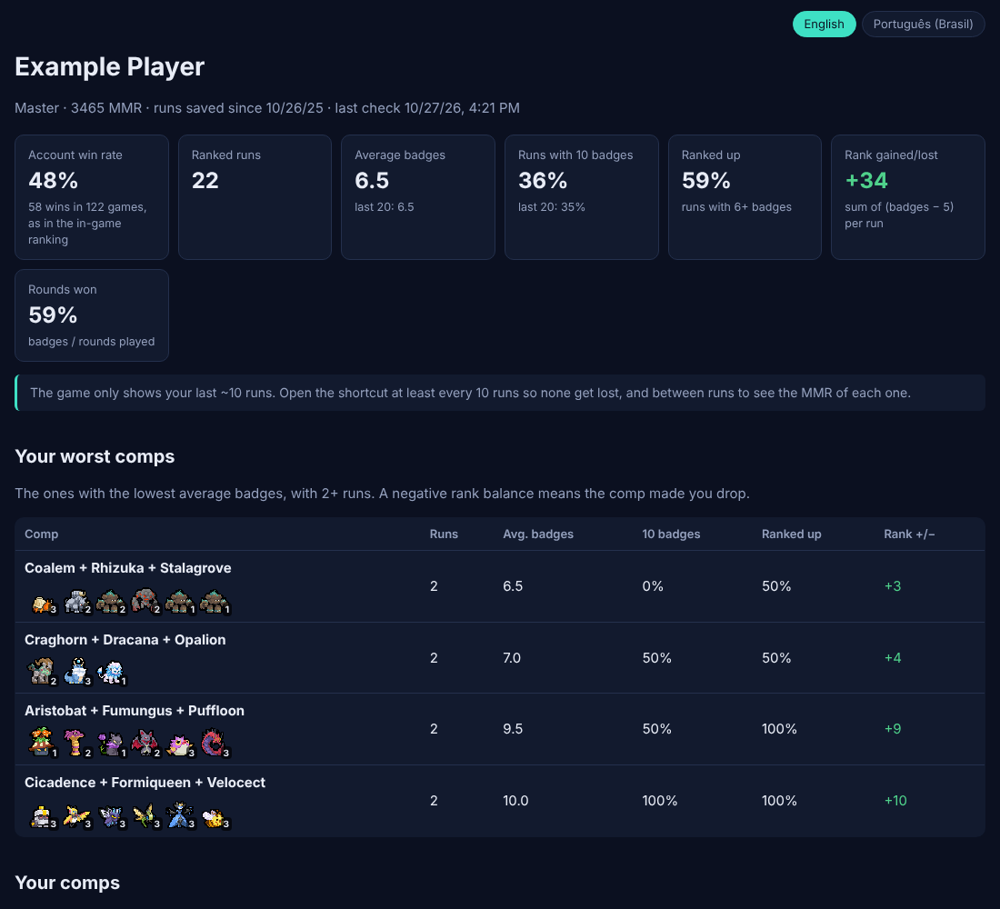

# Batomon Match History

Keep your own **Batomon Showdown** ranked history on your computer: every run you play, your win rate, average badges, which comps, trainers and Batomon gain or lose you rank, your MMR over time, and more.

The game itself only remembers your last ~10 runs. This tool saves each one as it shows up, so your history keeps growing.

The page is available in **English** and **Português (Brasil)**, with a button to switch.



> Unofficial fan-made tool, not affiliated with berrymint (the developer of Batomon Showdown). It reads the game's public but undocumented API, which may change or stop working at any time.

## Install (Windows)

1. Go to the [**Releases**](https://github.com/PedroBrock/batomon-match-history/releases/latest) page and download `BatomonMatchHistory.exe`.
2. Double-click it. Windows may show **"Windows protected your PC"** because the file is not digitally signed (signing costs money). Click **More info**, then **Run anyway**. The source code is all here if you want to check what it does.
3. Choose your language, type your in-game name (or your 15-character player ID) and pick your account.
4. Say yes to the desktop shortcut.

Your page opens in the browser. From then on, **click the "Batomon Match History" shortcut before playing** (and again after). Each click fetches your new runs, updates the page and opens it. Nothing keeps running in the background.

### Tips

- The game API only shows the last ~10 runs of an account, so click the shortcut **at least once every 10 runs** or older runs are lost.
- The API only gives your *current* MMR. If you click the shortcut between runs, each run gets its own MMR change on the page.
- Only ranked runs are saved. Abandoned runs are listed but left out of the averages.

### Where your data lives

Everything stays on your computer, in `%LOCALAPPDATA%\BatomonMatchHistory` (paste that in the File Explorer address bar):

| File | What it is |
| --- | --- |
| `history.json` | All your saved runs and MMR checks |
| `config.json` | Your account and language |
| `index.html` | The page |
| `BatomonMatchHistory.exe` | The copy the shortcut runs |

To move your history to another PC, copy `history.json` and drag it onto `BatomonMatchHistory.exe` there. It is merged with what is already saved.

### Update

Download the new `BatomonMatchHistory.exe` from Releases and run it once. It replaces the installed copy and your history is kept.

### Uninstall

Delete the desktop shortcut and the `%LOCALAPPDATA%\BatomonMatchHistory` folder.

## Command line

The .exe also takes commands (run it from a terminal):

```
BatomonMatchHistory.exe                 first-time setup if needed, then sync and open the page
BatomonMatchHistory.exe setup "Name"    pick the account (or use your player ID)
BatomonMatchHistory.exe sync            fetch new runs and rebuild the page
BatomonMatchHistory.exe report          rebuild the page only
BatomonMatchHistory.exe open            open the page
BatomonMatchHistory.exe shortcut        create the desktop shortcut
BatomonMatchHistory.exe lang pt-BR      change the language (en or pt-BR)
BatomonMatchHistory.exe import <file>   merge a history.json from elsewhere
```

## Run from source (macOS, Linux, or if you prefer)

Requires [Node.js](https://nodejs.org) 20 or newer.

```sh
git clone https://github.com/PedroBrock/batomon-match-history
cd batomon-match-history
npm install
npm start                  # same as double-clicking the .exe
npm start -- sync          # any command from the list above
```

On macOS the data goes to `~/Library/Application Support/BatomonMatchHistory`, on Linux to `~/.local/share/batomon-match-history`. Set `BMH_DATA_DIR` to use another folder.

## Development

```sh
npm test            # unit tests
npm run typecheck
npm run build:exe   # Windows .exe in dist/ (needs Bun: https://bun.sh)
```

| Path | What it does |
| --- | --- |
| `src/main.ts` | Entry point: first-time setup, commands, console messages |
| `src/api.ts` | Reads the game API and converts profiles and runs |
| `src/store.ts` | Data folder, settings, history and how new runs are merged |
| `src/stats.ts`, `src/comps.ts` | Win rate, badges, rank balance; comps grouped by 3 core Batomon |
| `src/report.ts` | The HTML page (one file, sprites inlined) |
| `src/i18n.ts` | All texts in English and Portuguese |
| `src/platform.ts` | Opening the page, the desktop shortcut, installing the .exe |

Releases are built by GitHub Actions: bump `version` in `package.json`, then run the **Release** workflow from the Actions tab (or push a tag like `v0.2.0`). It builds `BatomonMatchHistory.exe` with Bun and attaches it to a new release. Every pull request also builds the .exe as a downloadable artifact.

### How the data is read

The game backend (`api.batomon.app`) is a PocketBase server. The public `player_profiles` collection holds each account's rank, MMR, games, wins and its ~10 most recent runs (trainer, final team, round, badges, outcome). The tool makes two small requests per sync and identifies itself with a `User-Agent` that links to this repository. Profiles also contain the account's Steam ID; this tool never stores or shows it.

Ranked rules used for the stats: a run starts with 10 lives and ends at 0 lives or 10 badges; the rank changes by badges − 5 (5 keeps it, 6 is +1, 4 is −1).

## Credits

Batomon Showdown and all its artwork belong to berrymint.

## License

Source code under the [MIT License](LICENSE). Game sprites and data are not covered by it.
